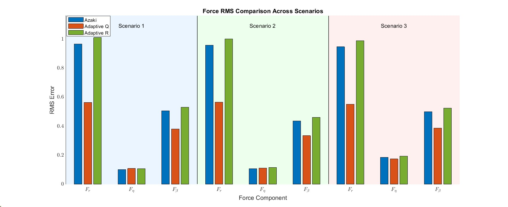

# UAV Magnus Simulator & Onboard Force Estimation

MATLAB/Simulink models and an illustrated advanced-research study of **adaptive covariance tuning for disturbance-force estimation in tethered aerial vehicles**.

## Explore the project

| Start here | What you will find |
|---|---|
| [Advanced Research Project - detailed results](docs/force-estimation/README.md) | Three reference scenarios, exact RMS tables, estimator comparisons, initialisation study and outdoor PID/SMC flight figures |
| [Results metrics (CSV)](docs/force-estimation/metrics.csv) | Force-component RMS values transcribed from the original plot labels |
| [Figure provenance](docs/force-estimation/PROVENANCE.json) | Original figure paths and content hashes |
| [Simulation datasets release](https://github.com/yonatantamiru65-tech/uav-magnus-simulator/releases/tag/data-v1) | Existing wind inputs, lookup tables and saved simulation data |

### Research highlights

The academic study compared a baseline EKF with Adaptive Q and Adaptive R. **Adaptive Q reduced radial-force RMS by 40.8-41.8% across three simulated reference scenarios**. The benefit depends on force component; elevation-force error did not improve in every scenario. Outdoor PID/SMC records provide a qualitative comparison with an indirect radial winch reference.



**Academic team:** Abdelateef Negmelden and Yonatan Tamiru Asfaw. **Supervision:** Prof. Nacim Meslem and Jonathan Dumon, Grenoble INP / GIPSA-lab. The existing underlying simulator retains its original authorship credits. See the detailed gallery for scope and sources.

---

## Simulator collection

## Project overview

The supplied model combines quadrotor dynamics, Magnus aerodynamic forces, actuator models and tether/winch parameters. Supporting scripts cover optimization, state transformations, controller mixing and plotting. Saved figures compare responses labelled SMC and STSM in the original files.

## Repository guide

| Location | Contents |
| --- | --- |
| `UAV_SIMULATOR_MAIN_0.m` | Main parameter and simulation setup script |
| `UAV_SIMULATOR_CA_2021a.slx` | Simulink simulator model |
| `Functions/` | Dynamics, transformations, mixers, aerodynamic and optimization helpers |
| `runOptimizationHelper.m` | Nonlinear optimization helper using `fmincon` |
| Dataset release: `wind_data*.mat` | Supplied wind input datasets |
| `logs/Magnus Aero Model/` | Aerodynamic reference plots and coefficient tables |
| Dataset release: `logs/Magnus Size Study/` | Lookup-table data |
| Root `.pdf`, `.jpg`, `.fig`, `.eps` files | Saved plots and visual outputs |

## Large simulation datasets

All 11 MAT files (saved simulation outputs, wind inputs and lookup-table data) are distributed separately in the [simulation datasets release](https://github.com/yonatantamiru65-tech/uav-magnus-simulator/releases/tag/data-v1).

Download `uav-magnus-simulation-datasets.zip` from **Assets**, then extract it into the repository root. The ZIP preserves the root and `Functions/` paths expected by the original collection.

## Setup

1. Download or clone this repository.
2. Restore the dataset release into this directory; the main setup script loads `wind_data1.mat`. Other MAT files support plotting and analysis workflows.
3. Open the repository directory in MATLAB and inspect `UAV_SIMULATOR_MAIN_0.m` before running it.
4. Add the helper folder to the MATLAB path:

```matlab
addpath('Functions');
```

5. Inspect the setup script, then open `UAV_SIMULATOR_CA_2021a.slx` with its required workspace variables available.

**Dependencies:** MATLAB and Simulink; Optimization Toolbox is used by `fmincon` and `optimoptions`. Some workflows may require [YALMIP](https://github.com/yalmip/YALMIP) and a suitable solver. Install dependencies separately. The supplied `Yalmip_Install.m` downloads YALMIP and changes the MATLAB path; review it before use.

## Compatibility and verification

The model filename references R2021a; compatibility with any specific release has not been verified. MATLAB and Simulink have not been run during repository preparation. Original scripts are preserved, including their existing path assumptions. The main setup script refers to a generated `codegen` directory, which is intentionally omitted; regeneration or path adjustments may be needed for your workflow.

Generated build folders (`slprj`, `codegen`), compiled/cache files, editor backups, machine-specific `pathdef.m` files, model backup versions and the bundled YALMIP distribution are excluded.

## Attribution

Project collection supplied by Yonatan Tamiru Asfaw. The main simulator script retains its original header crediting Pierre Susbielle / GIPSA-Lab. Existing author notices are preserved; this repository does not claim sole authorship of the underlying simulator. No new software license has been assigned.

The [advanced force-estimation results gallery](docs/force-estimation/README.md) documents selected academic simulation and flight-data results. The added gallery is not a complete reproduction package for the adaptive estimators.
