# Onboard Force Estimation for Aerial Vehicles

**Advanced Research Project | Master MARS, Grenoble INP - Ense3**

Project team: **Abdelateef Negmelden and Yonatan Tamiru Asfaw**. Supervision: **Prof. Nacim Meslem and Jonathan Dumon**. These credits follow the supplied academic presentation (`main.tex`).

This gallery documents a force-estimation study for a tethered Magnus-based winged quadcopter. It compares a fixed-covariance extended Kalman filter (EKF), online process-noise adaptation (Adaptive Q), and measurement-noise adaptation (Adaptive R), using simulation and supplied outdoor flight records.

[Repository overview](../../README.md) | [Numerical results](#simulation-results) | [Three scenarios](#three-simulation-scenarios) | [Flight-data comparisons](#flight-data-comparisons) | [Metrics CSV](metrics.csv) | [Figure provenance](PROVENANCE.json)

## Key findings

- Adaptive Q reduced **radial-force RMS error by about 41-42%** relative to the baseline in each of the three simulation scenarios.
- Azimuth-force RMS also improved by approximately **23-25%**. Improvement was component-dependent: elevation-force RMS was slightly worse in Scenarios 1 and 2, and better in Scenario 3.
- Adaptive R was close to the baseline, with no improvement in the nine component/scenario RMS values listed below.
- Identity-initialised Adaptive Q remained usable in the supplied run, but did not match the performance of baseline-initialised Adaptive Q. The eigenvalue plot alone does not prove filter stability or statistical consistency.
- PID- and SMC-controlled outdoor flight plots provide a **qualitative radial-force comparison with an indirect winch reference**. They do not establish ground-truth error for every force component.

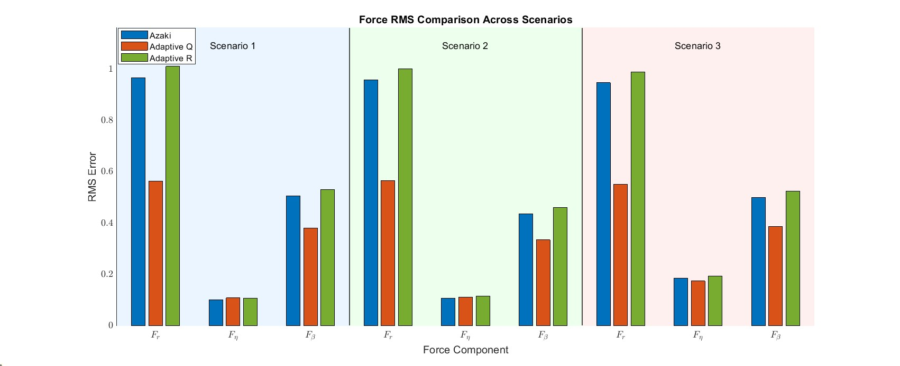

*The original overview figure labels the baseline as "Azaki". The exact numbers below are transcribed from the individual force-plot titles, not estimated from bar heights.*

## System and estimation approach

The nine-state model uses tether-aligned spherical coordinates:

`x = [r, r_dot, eta, eta_dot, beta, beta_dot, f_r, f_eta, f_beta]`.

The first six states describe radial position, elevation, azimuth and their rates; the final three are unknown force components. The direct measurement model uses position coordinates, while the EKF propagates the nonlinear dynamics and linearises locally. Force states are treated as locally constant between updates.

| Estimator | Process covariance Q | Measurement covariance R | Purpose |
|---|---|---|---|
| Baseline EKF | Fixed | Fixed | Reference tuning from the supplied Azaki-based framework |
| Adaptive Q | Updated online | Fixed at baseline | Follow changing process/model uncertainty |
| Adaptive R | Fixed at baseline | Updated online | Adapt measurement-noise weighting |
| Identity-initialised Adaptive Q | Initial Q = I, then updated | Fixed at baseline | Examine sensitivity to non-informative initialisation |

The presentation specifies forgetting factor **alpha = 0.9**. Baseline tuning is `Q = diag(1e-10, 20, 1e-10, 20, 1e-10, 20, 80, 80, 80)` and `R = diag(1e-10, 1e-10, 1e-10)`. These are recorded settings, not a recommendation for another vehicle. The supplied presentation contains differing covariance-update expressions in its summary and algorithm slides; use the actual estimator implementation to reproduce an update law, rather than treating this gallery as executable filter code.

## Three simulation scenarios

All three original reference plots span approximately **60 s** and include ramp-up, hold, ramp-down and final-hold phases. The accompanying rate profiles show the associated transitions.

| Scenario | Radial reference r | Elevation eta | Azimuth beta | What changes |
|---|---|---|---|---|
| 1 | 0.5 to 1.5 m and back | 0 to 25 deg and back | 20 to 45 deg and back | Nominal reference |
| 2 | Same as Scenario 1 | 0 to 50 deg and back | Same as Scenario 1 | Larger elevation excursion |
| 3 | Same as Scenario 1 | Same as Scenario 1 | 20 to 60 deg and back | Larger azimuth excursion |

**Scenario-label correction:** `main.tex` calls Scenario 2 an increased radial reference, but the figures show an unchanged radial profile and a doubled elevation excursion. This documentation follows the plotted axes and values. The original image files are unchanged.

| Scenario 1 | Scenario 2: elevation | Scenario 3: azimuth |
|---|---|---|
| 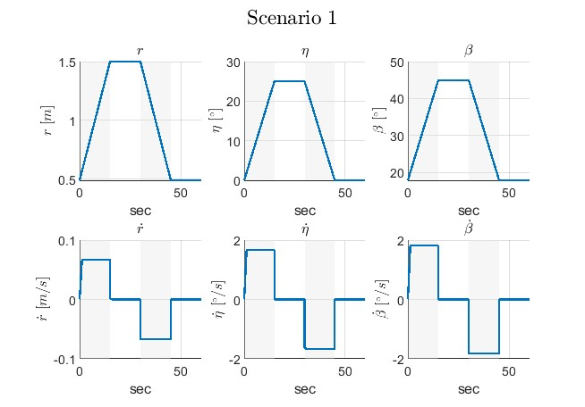 | 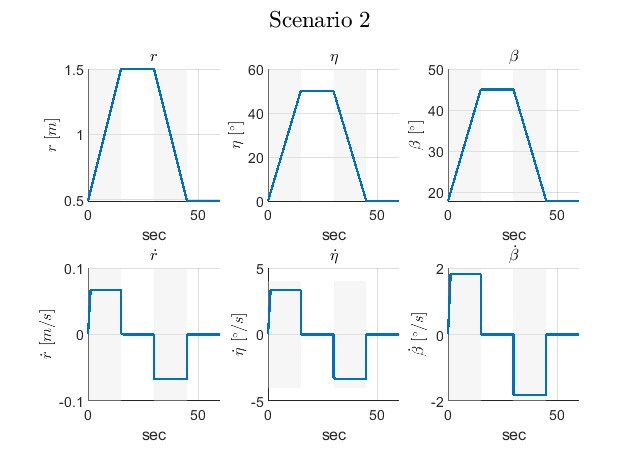 | 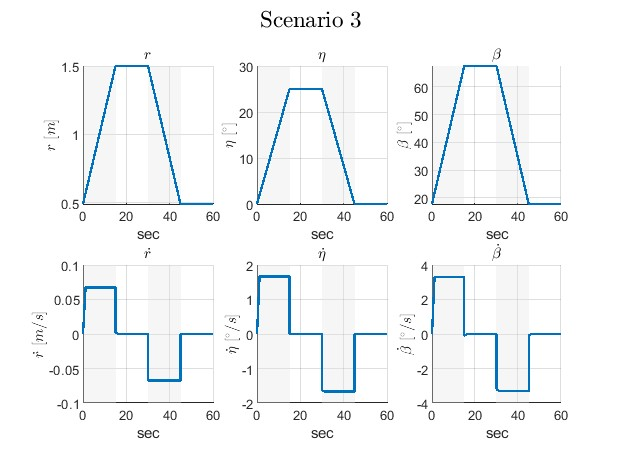 |

## Simulation results

RMS denotes `sqrt(mean((estimated force - simulated reference force)^2))`, in newtons. The supplied curves are labelled "Estimated" and "Real"; here "Real" means simulator ground truth. These are archived results; simulations were not rerun for this documentation update.

| Scenario | Method | Radial force RMS (N) | Elevation force RMS (N) | Azimuth force RMS (N) |
|---|---|---:|---:|---:|
| 1 | Baseline EKF | 0.96889 | 0.10231 | 0.50805 |
| 1 | Adaptive Q | 0.56558 | 0.10962 | 0.38261 |
| 1 | Adaptive R | 1.01301 | 0.10787 | 0.53291 |
| 2 | Baseline EKF | 0.95980 | 0.10839 | 0.43829 |
| 2 | Adaptive Q | 0.56777 | 0.11318 | 0.33618 |
| 2 | Adaptive R | 1.00325 | 0.11694 | 0.46198 |
| 3 | Baseline EKF | 0.94902 | 0.18664 | 0.50105 |
| 3 | Adaptive Q | 0.55245 | 0.17521 | 0.38780 |
| 3 | Adaptive R | 0.99196 | 0.19526 | 0.52537 |

The radial reductions, calculated as `(baseline - Adaptive Q) / baseline x 100`, are **41.6%, 40.8%, 41.8%** for Scenarios 1, 2 and 3 respectively. Values are rounded from the five-decimal RMS labels.

### Scenario 1 - nominal reference

| Baseline EKF | Adaptive Q | Adaptive R |
|---|---|---|
|  | 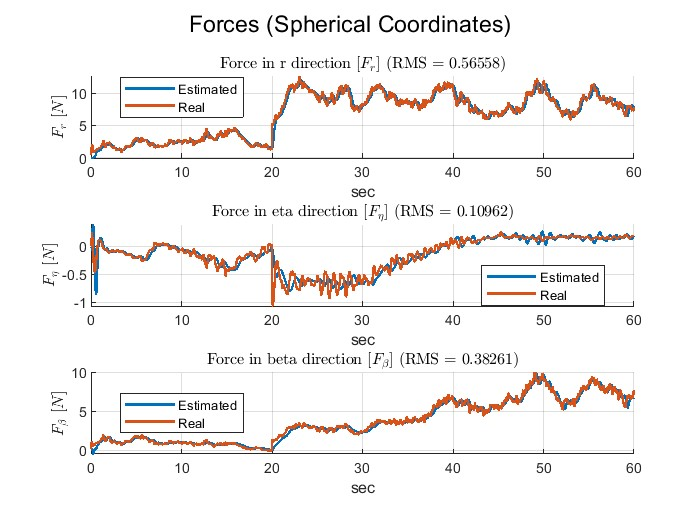 |  |

Adaptive Q reduces radial RMS from **0.96889 to 0.56558 N** and azimuth RMS from **0.50805 to 0.38261 N**. Elevation RMS increases from **0.10231 to 0.10962 N**. This component trade-off is why a blanket "lowest error for every force" claim would be inaccurate.

### Scenario 2 - larger elevation excursion

| Baseline EKF | Adaptive Q | Adaptive R |
|---|---|---|
|  | 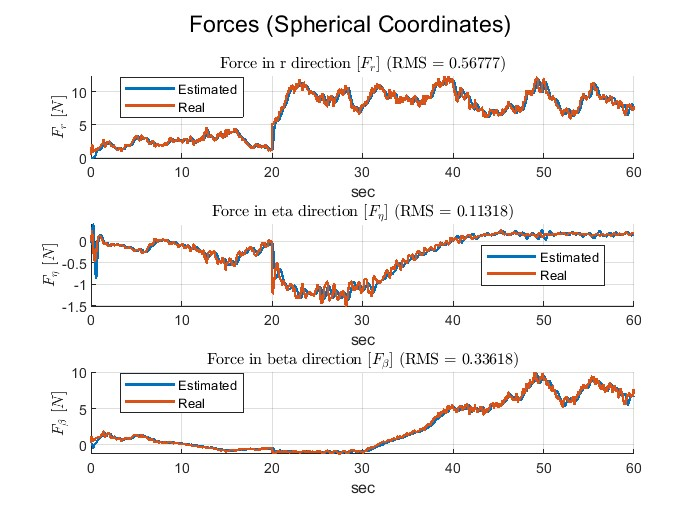 | 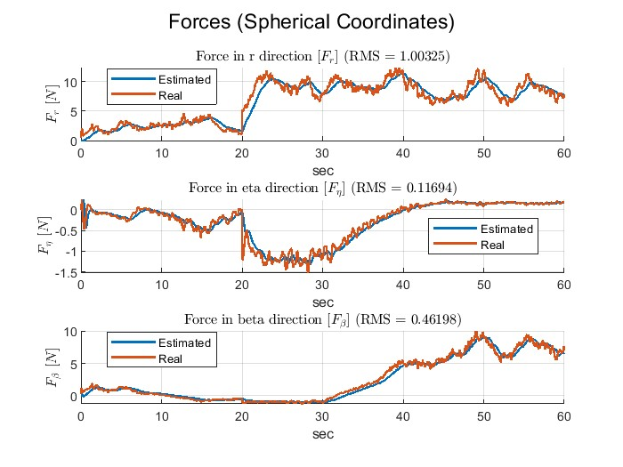 |

Radial RMS falls from **0.95980 to 0.56777 N**, and azimuth RMS from **0.43829 to 0.33618 N**. Elevation RMS increases slightly from **0.10839 to 0.11318 N**. The stronger elevation reference therefore preserves the main radial benefit without producing uniform improvement in every component.

### Scenario 3 - larger azimuth excursion

| Baseline EKF | Adaptive Q | Adaptive R |
|---|---|---|
| 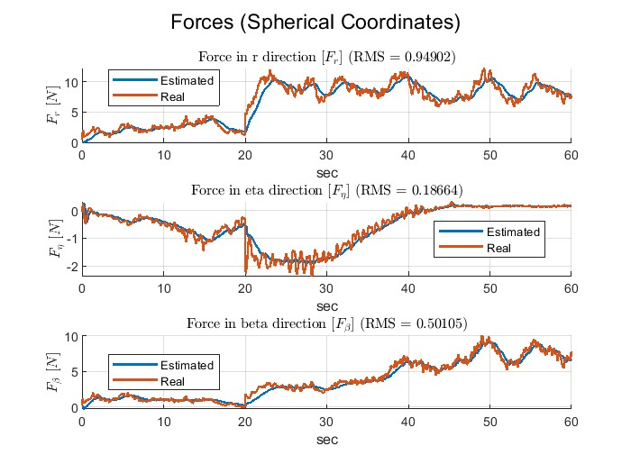 | 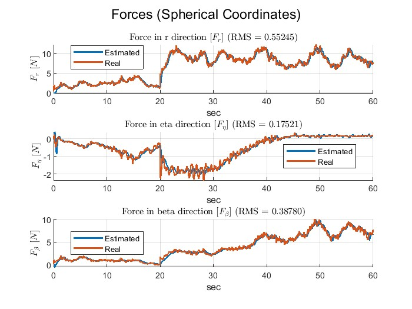 | 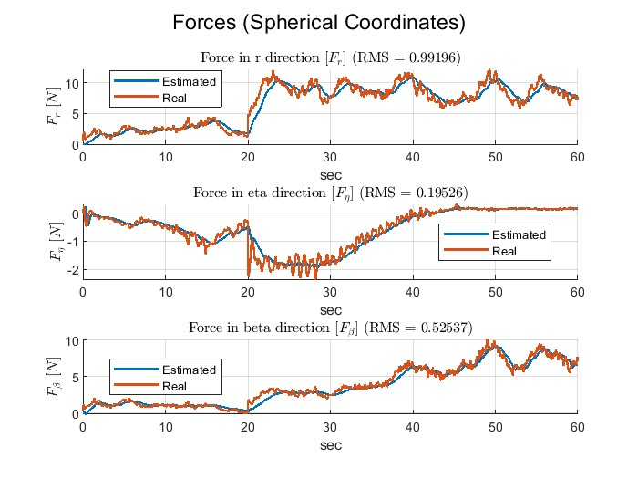 |

Adaptive Q improves all three reported RMS values in this scenario: radial **0.94902 to 0.55245 N**, elevation **0.18664 to 0.17521 N**, and azimuth **0.50105 to 0.38780 N**. The azimuth-force waveform changes substantially during the commanded transitions.

### Initialisation sensitivity

| Adaptive Q initialised with Q = I | Recorded Q eigenvalues |
|---|---|
| 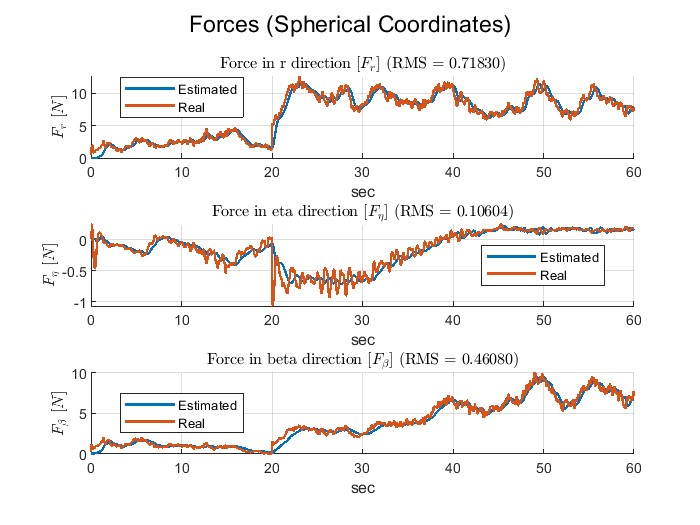 | 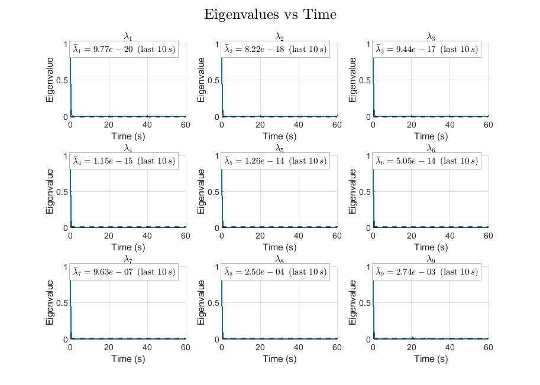 |

For Scenario 1, identity initialisation gives RMS **0.71830 N (radial), 0.10604 N (elevation), 0.46080 N (azimuth)**. It improves radial and azimuth error over the baseline, but radial improvement is approximately **25.9%**, rather than the **41.6%** achieved using the baseline initial Q. The eigenvalues decrease rapidly and several approach very small values; this is a diagnostic trace, not a proof of convergence, consistency or positive definiteness at every numerical step.

## Flight-data comparisons

The presentation describes outdoor records under **PID** and **sliding mode control (SMC)**, with references `r_d = 20 m`, `eta_d = 0 deg`, `beta_d = 45 deg`. The plotted records span about 60 s. The academic presentation and the later paper slides identify these as supplied experimental datasets, rather than flights newly conducted for this repository.

### PID-controlled record

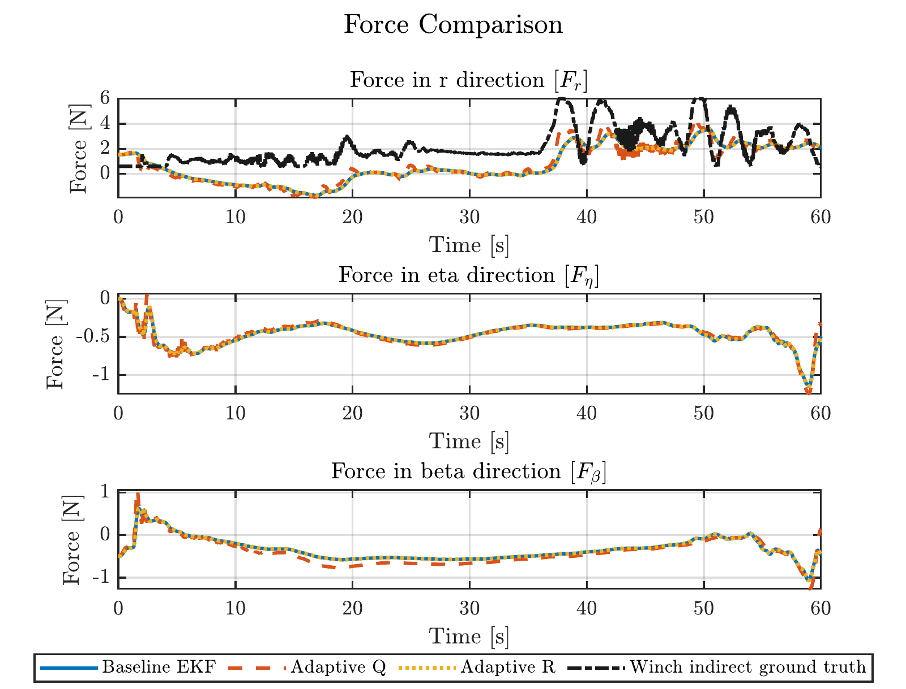

Blue: baseline EKF; orange: Adaptive Q; yellow: Adaptive R. The dashed black curve is explicitly labelled **"Winch indirect ground truth"** and appears in the radial panel only. The methods follow similar broad trends; Adaptive Q changes the transient response, but all estimates visibly differ from the indirect reference during parts of the record. No quantitative flight accuracy improvement is claimed from this plot.

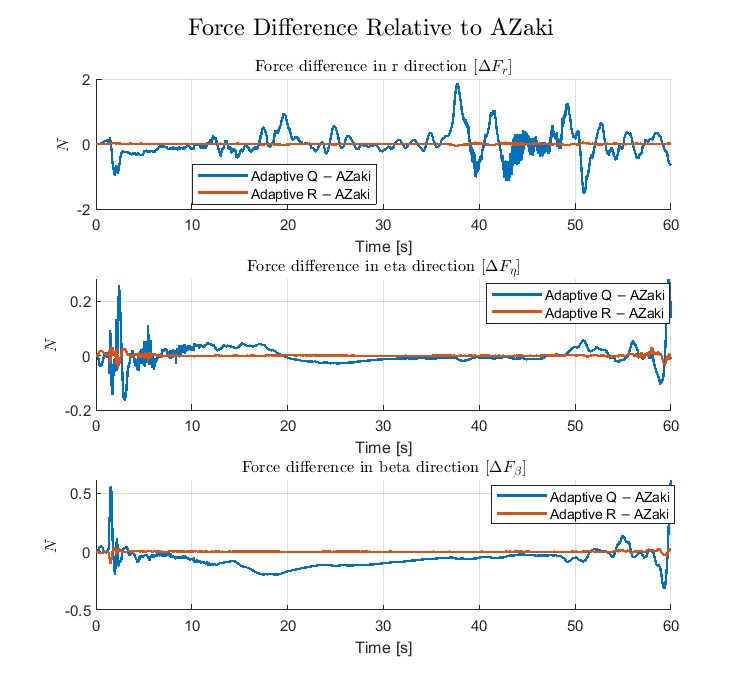

*Differences between estimators show how adaptation changes the estimates; a difference from baseline is not itself a measurement of accuracy.*

### SMC-controlled record

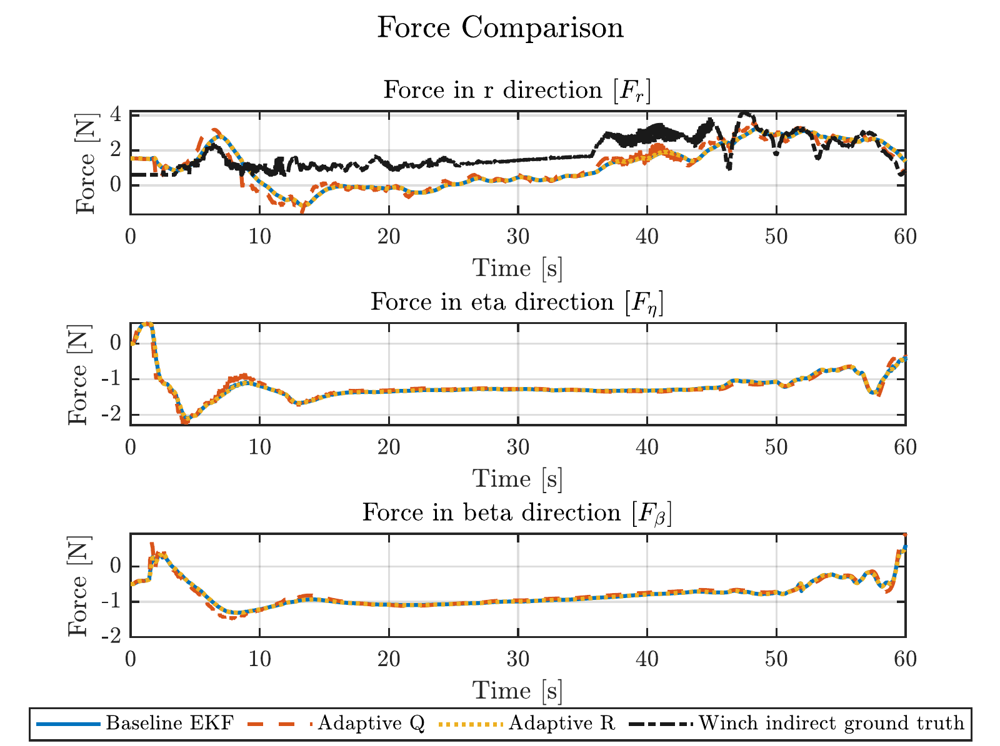

The same three estimators are compared under SMC control. The radial winch reference offers a qualitative check, while no equivalent independent reference is shown for the elevation and azimuth force components. Agreement in trend does not establish full-vector force ground truth.

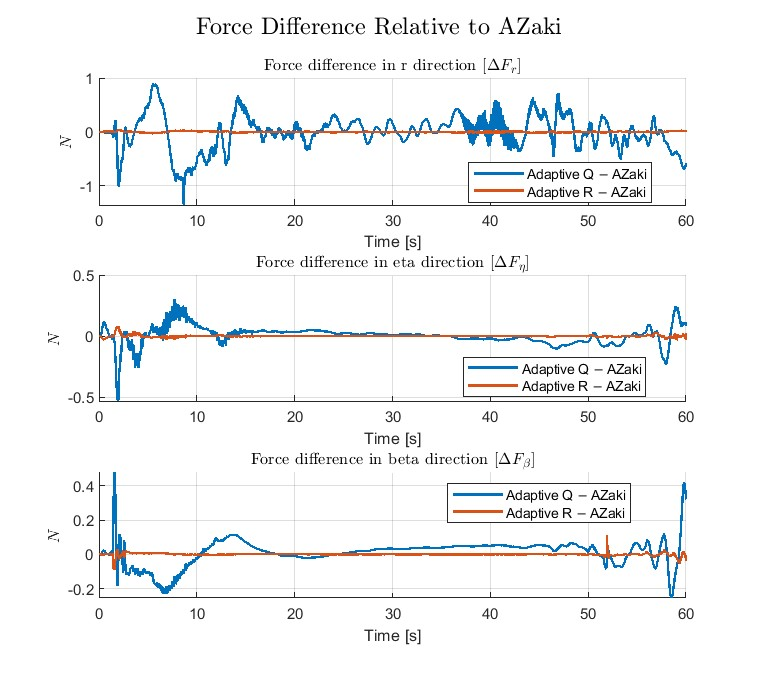

## Scope, attribution and reproduction

- **Team contribution:** this is a joint academic force-estimation project by Abdelateef Negmelden and Yonatan Tamiru Asfaw, supervised by Nacim Meslem and Jonathan Dumon. It builds on the Azaki Magnus-based quadcopter framework; the underlying simulator retains its original Pierre Susbielle / GIPSA-lab credits.
- **Presentation vs publication:** `Paper_PPT.tex` lists a different author group and describes a CoDIT 2026 paper presentation. This gallery does not imply that Yonatan is an author of that paper or that the coursework itself is a published paper.
- **Sources:** the supplied `main.tex`, `Paper_PPT.tex`, and figure folders are the evidence for this gallery. Only selected result figures and their descriptions are published here; institutional logos and contextual third-party illustrations are omitted.
- **Data reference as cited in the paper slides:** Azaki et al., *Indoor and outdoor flights for tethered Magnus-effect winged quadcopter system under wind disturbance*, Recherche Data Gouv, V1 (2026), [DOI:10.57745/MVGMUH](https://doi.org/10.57745/MVGMUH). Dataset metadata and redistribution terms should be checked at the source before redistributing raw flight data.
- **Model reference as cited in the coursework:** Azaki, *Autonomous Magnus-Based Winged Quadcopter System for Prolonged Flight and Tethered Airborne Wind Energy Applications*, Université Grenoble Alpes, PhD thesis (2024).
- **Reproduction limit:** this update adds a documented archive of results. It does not add a complete Adaptive EKF implementation, raw estimation logs, or missing run settings. The existing simulator setup and data release remain linked in the repository overview. The simulator by itself is not sufficient evidence that every figure here can be regenerated.
- **Future work, not completed claims:** joint Q/R adaptation, PSO-assisted tuning, UKF comparison and broader experimental validation are discussed in the slides as future directions.

All JPEG figures are copied without modifying chart contents. The two flight PNGs are direct renders of the supplied PDF figures. `PROVENANCE.json` maps each published file to its original relative path and SHA-256 digest.
